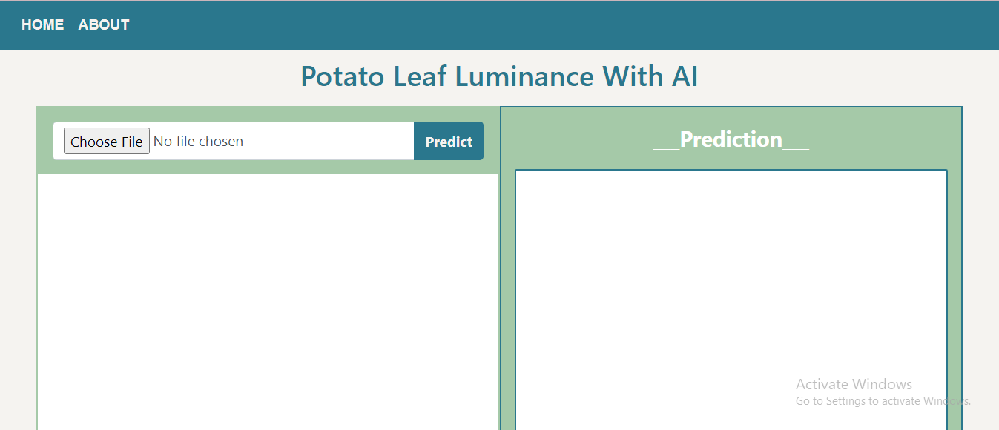
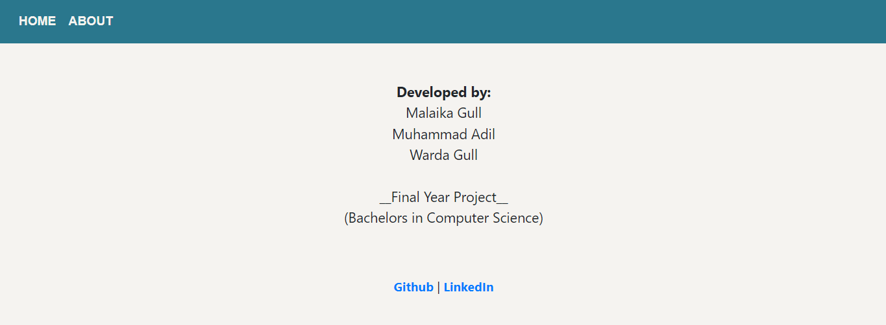
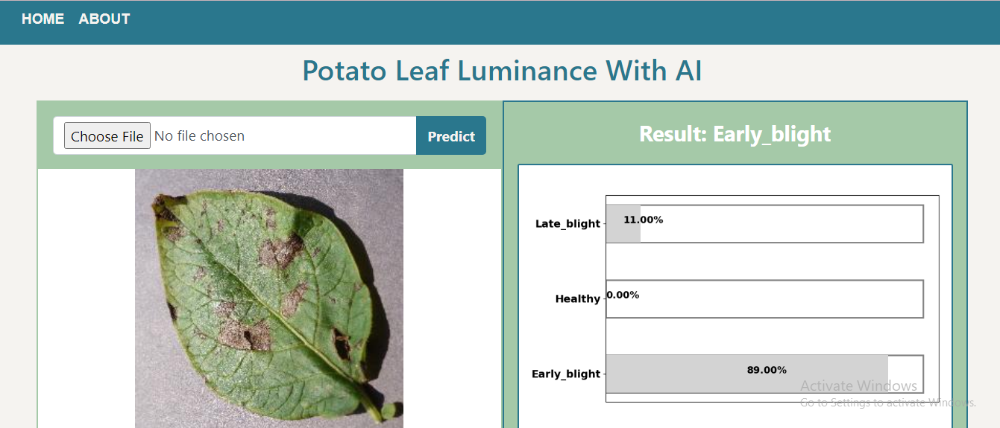
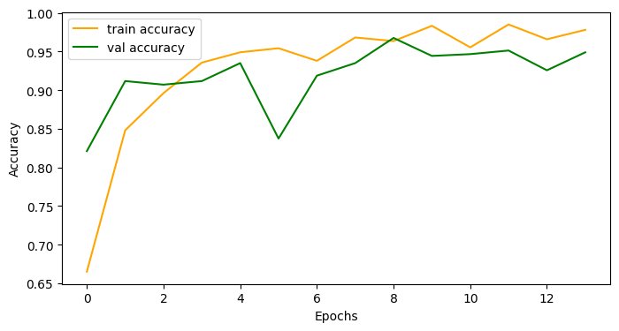
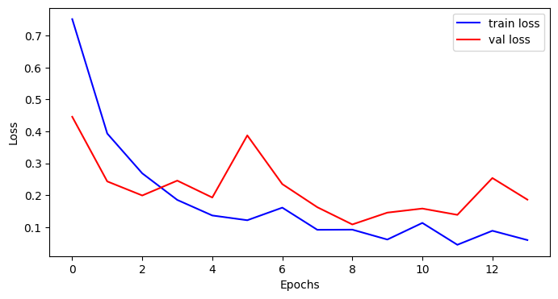

# Potato Leaf Disease Classification Using CNN

A deep learning web application that identifies potato leaf diseases from uploaded leaf images. The project uses a Convolutional Neural Network (CNN) trained to classify potato leaves into three categories: Early Blight, Late Blight, and Healthy.

## Application Screenshots

### Home Page


### About Page


### Prediction Result


The application displays the predicted disease class along with prediction probabilities.

## Model Performance

The CNN model achieved **95.72% validation accuracy** during training.

### Training Accuracy


### Training Loss


*Note: This is validation performance, not accuracy measured on an independent test dataset.*

## Features

- Upload potato leaf images for disease classification.
- Classify images into three categories.
- Display prediction results and class probabilities.
- Visualize prediction probabilities using a chart.
- Store uploaded images in a local SQLite database.
- Web interface built with Flask.

## Disease Categories

The model identifies the following classes:

1. **Early Blight**
2. **Healthy**
3. **Late Blight**

## Technologies Used

- Python
- TensorFlow and Keras
- Convolutional Neural Network (CNN)
- Flask
- NumPy
- Matplotlib
- SQLite
- HTML, CSS, Bootstrap and JavaScript

## Model Details

- Model type: Convolutional Neural Network (CNN)
- Input image size: 128 × 128 pixels
- Input channels: 3 (RGB)
- Output: 3 class probabilities
- Activation function in output layer: Softmax
- Optimizer: Adam
- Loss function: Sparse Categorical Crossentropy

The trained model is saved in:

`application/static/models/model_v1.h5`

## Project Structure

```text
FYP_project/
│
├── application/
│   ├── static/
│   │   ├── models/
│   │   │   └── model_v1.h5
│   │   └── uploads/
│   ├── templates/
│   ├── __init__.py
│   ├── config.py
│   └── views.py
│
├── development/
│   └── Potato Leaf Disease Classification v2.ipynb
│
├── images-md/
├── Project_images/
├── Test_Images/
├── app.py
├── requirements.txt
├── .gitignore
└── README.md
```

## Installation and Setup

### 1. Clone the Repository

```bash
git clone https://github.com/YOUR_USERNAME/YOUR_REPOSITORY.git
cd YOUR_REPOSITORY
```

Replace the repository URL with your GitHub repository URL.

### 2. Create a Virtual Environment

Python 3.12 is recommended for the tested setup.

```bash
python -m venv .venv
```

Activate it on Windows:

```powershell
.venv\Scripts\activate
```

### 3. Install Dependencies

```bash
python -m pip install -r requirements.txt
```

### 4. Run the Application

```bash
python app.py
```

Open the following address in your browser:

`http://127.0.0.1:5000`

## Dataset and Training

The project uses a dataset of potato leaf images belonging to the three classification categories.

The model development notebook is available in the `development/` directory.

The original training dataset is not included in this repository because of its size. The trained model is included, so the Flask application can make predictions without retraining the model.

## Future Improvements

- Improve classification performance using additional and diverse training images.
- Evaluate the model on an independent test dataset.
- Explore deployment options to make the application publicly accessible.

---

**Academic Project:** Final Year Project (BS Computer Science)